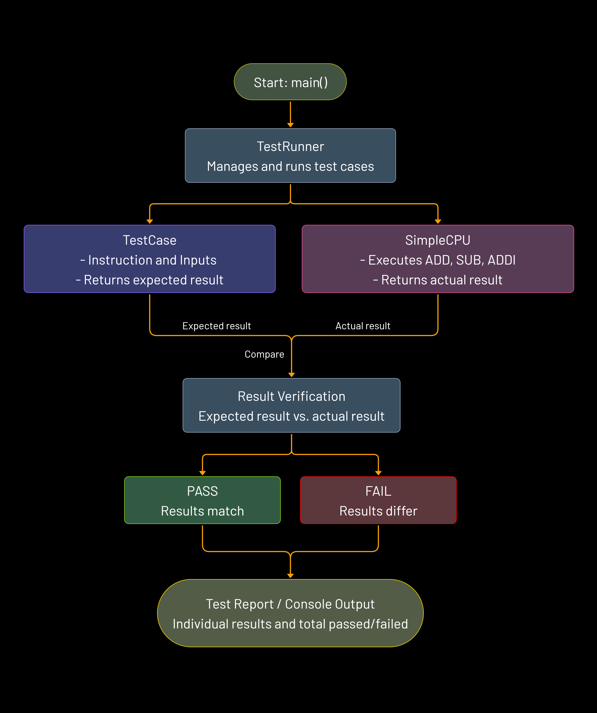

# RISC-V CPU Verification Tool

A Java tool that tests ADD, SUB, and ADDI in a simple RISC-V CPU model.

## The Problem

I wanted to check CPU results without doing each calculation by hand. The tool makes it easy to run the same tests after changing the code.

## How It Works

`SimpleCPU` runs each instruction. `TestRunner` compares the result with the expected answer and prints PASS or FAIL. The report also shows how many times each instruction ran.



## Tech Stack

- Java 21 and the Java standard library
- Git and GitHub
- CPU registers and test cases stored in memory

## Setup and Run

1. Install [Git](https://git-scm.com/install/) and [JDK 21](https://learn.microsoft.com/en-us/java/openjdk/download).
2. Open a new terminal, clone the repo, and compile:

   ```sh
   git clone https://github.com/noturgf01/risc-v-cpu-verification-tool.git
   cd risc-v-cpu-verification-tool
   javac -d out src/*.java
   ```

3. Run the predefined tests and the random tests:

   ```sh
   java -cp out Main
   java -cp out Main --random
   ```

   Example input: `ADD x3, x1, x2` with `x1 = 10` and `x2 = 20`.

   ```text
   Instruction: ADD
   Expected: 30
   Actual: 30
   Result: PASS
   ```

   The first run has 5 predefined tests and 3 invalid-input checks. The random run has 300 tests. Coverage of `3/3` means all three instructions were tested.

## Roadmap

I focused on getting the Java tests and instruction coverage working first. The SystemVerilog ALU is a future step.

- [x] Set up the Java project.
- [x] Add CPU registers and implement ADD, SUB, and ADDI.
- [x] Add TestCase, TestRunner, and predefined tests.
- [x] Add error messages for invalid inputs.
- [x] Publish the Java MVP as v0.1.0.
- [x] Add seeded random tests.
- [x] Track instruction coverage.
- [ ] Build a simple ALU in SystemVerilog and check it against Java.
- [ ] Add memory and branch instructions.

## Demo

[Video walkthrough](https://youtu.be/1o7hj1q8fd8)
